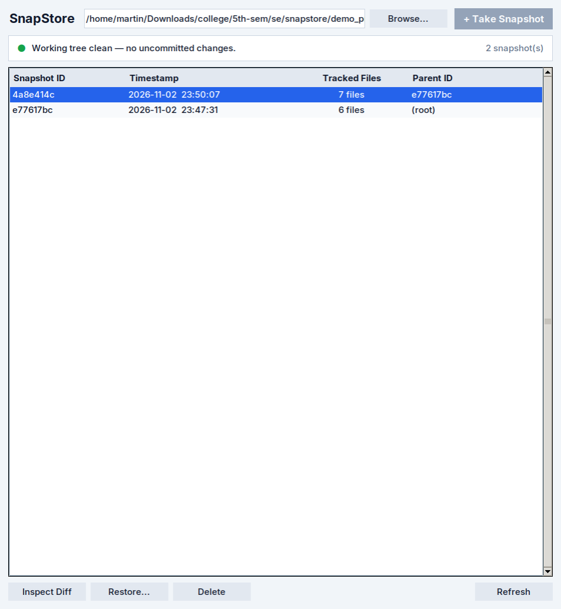

# SnapStore - Local Snapshot Backup System

A lightweight, local, content-addressed snapshot backup and recovery tool in Python.
Preserves directory states over time with SHA-256 deduplication and zero external runtime dependencies (Python standard library only).

## Setup and Testing

### Clone & Set Up Virtual Environment

```bash
git clone https://github.com/ps1ph3r/snapstore.git
cd snapstore

python3 -m venv .venv
source .venv/bin/activate
pip install pytest
pip install -e .
```

### Running Tests

Run the automated test suite with:

```bash
pytest
```

---

## Graphical User Interface (GUI)
Launch the desktop interface:
```bash
snapstore gui
```
  


---

## CLI Usage

### Usage Help
```bash
snapstore --help
```

```text
usage: snapstore [-h] [directory] <command> ...

SnapStore - Local snapshot-based backup and recovery system

positional arguments:
  directory      Target directory (default: current directory)
  <command>
    init         Initialize a directory for snapshots
    snapshot     Create a snapshot
    delete (rm)  Delete a snapshot by ID
    list         List all snapshots
    log          Display snapshot lineage history graph
    diff         Diff snapshots or current vs snapshot
    status       Show current directory status vs latest snapshot
    restore      Restore a snapshot
    gui          Launch graphical user interface

options:
  -h, --help     show this help message and exit
```

### 1. Initialize a Directory
Initialize a target directory for tracking (creates `.snapstore/`):
```bash
snapstore init .
```

### 2. Take a Snapshot
Capture the current state of the directory:
```bash
snapstore snapshot .
# Output: Created snapshot a1b2c3d4
```

### 3. Check Changes (Status)
Inspect what changed in the working directory since the last snapshot:
```bash
snapstore status
```
Output:
* `A <path>` = Added
* `M <path>` = Modified
* `D <path>` = Deleted

### 4. View Snapshots & History
List all snapshots chronologically:
```bash
snapstore list
```

Display the snapshot lineage graph:
```bash
snapstore log
```

### 5. Compare Snapshots (Diff)
* Compare two historical snapshots:
  ```bash
  snapstore diff <snapshot_id_1> <snapshot_id_2>
  ```
* Compare a snapshot against its parent:
  ```bash
  snapstore diff <snapshot_id> --parent
  ```
* Show line-level unified text diff of current uncommitted changes:
  ```bash
  snapstore diff
  ```

### 6. Restore Files
* **Restore entire snapshot** to a destination folder:
  ```bash
  snapstore restore <snapshot_id> ./restored_folder
  ```
* **Selective restore** (restore specific files only):
  ```bash
  snapstore restore <snapshot_id> ./restored_folder path/to/file.txt
  ```

### 7. Delete a Snapshot
Remove a snapshot from history and automatically rewind HEAD:

```bash
snapstore delete <snapshot_id>
```
